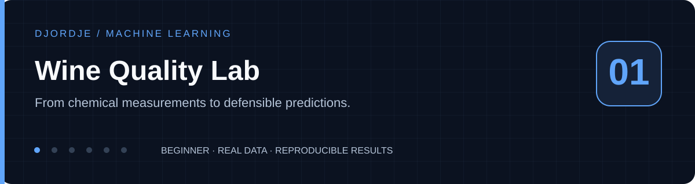
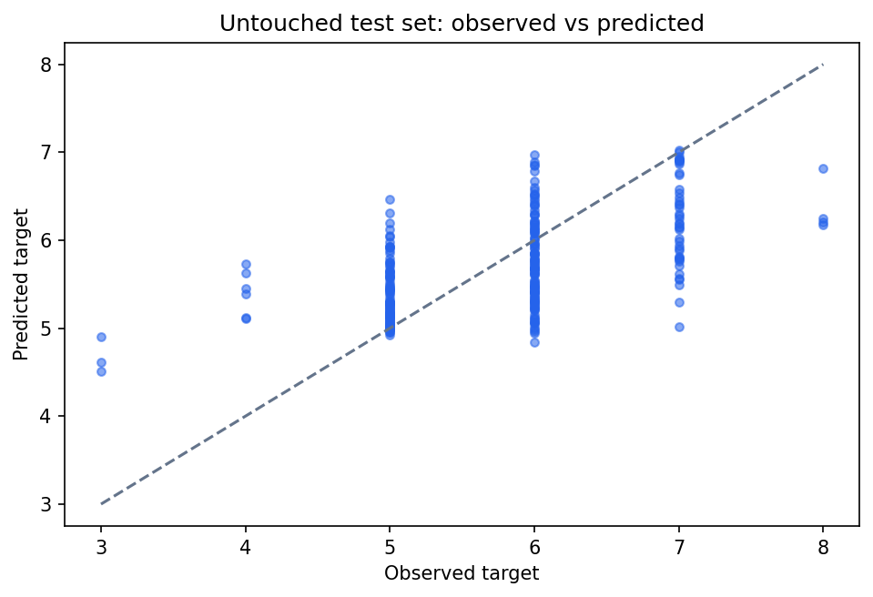
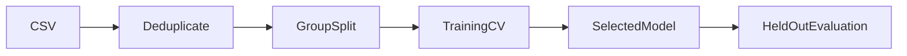
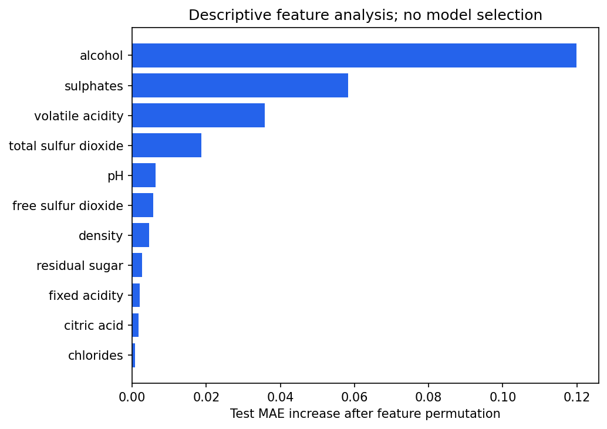

<p align="center"></p>

# Wine Quality Lab

**From chemical measurements to defensible predictions.**

[](https://github.com/Djordje3002/wine-quality-ml/actions/workflows/ci.yml)


Estimate the sensory quality of a Portuguese red wine from eleven laboratory measurements. The engineering goal is a small, inspectable regression pipeline that improves on predicting the mean score and prevents repeated measurements from inflating evaluation results.

**Project 1/6 · Beginner** in the [Machine Learning Portfolio](https://github.com/Djordje3002/ml-portfolio).

## What this project demonstrates

scikit-learn pipelines · grouped validation · random forests · permutation analysis.

Working training and prediction commands, real benchmark data, baseline comparisons, committed measured reports, an experiment-review notebook, regression tests and CI. This is a reproducible portfolio experiment; results describe the stated benchmark protocol.

## Measured results

| Model | mae | rmse | r2 |
| --- | ---: | ---: | ---: |
| `mean_baseline` | 0.7185 | 0.8581 | -0.0274 |
| `scaled_ridge` | 0.5549 | 0.7215 | 0.2737 |
| `random_forest_leaf2` | 0.5341 | 0.6904 | 0.3349 |
| `random_forest_leaf5` | 0.5366 | 0.6914 | 0.3330 |


**Selected using training CV or validation:** `random_forest_leaf5`. The tables report test results; selection is never changed to favor the test winner.

The forest with leaf size 5 was selected by training CV. The leaf-size-2 forest has slightly lower test MAE, but the selection stays unchanged. That difference is a useful example of why test results must not decide hyperparameters. Quality is an ordinal sensory judgment, and a fractional regression estimate is not a certification.



Full precision, split counts, package versions and source provenance are in [metrics.json](reports/metrics.json). The committed run used Python 3.11 on macOS with seed 42. Results can vary slightly across platforms and dependency versions. These numbers are benchmark measurements, not production performance promises.

## Run locally

Use Python 3.11 or 3.12 and run commands from the repository root. No API key, paid service or GPU is required. The first training run downloads the small source archive; subsequent runs verify and reuse the local cache. The digits project uses scikit-learn's bundled dataset instead.

```bash
git clone https://github.com/Djordje3002/wine-quality-ml.git
cd wine-quality-ml
python3.11 -m venv .venv
source .venv/bin/activate
python -m pip install -e ".[dev]"
python -m wine_quality train
python -m wine_quality predict --input examples/sample.json
python -m pytest -q
```

On Windows, activate with `.venv\Scripts\activate`. A Python 3.12 installation can replace `python3.11` in the setup command. Start with a few minutes of CPU time; training time depends on your machine, with the CNN and factorization requiring more work than the small tabular examples.

Training writes local models to `artifacts/` and refreshes `reports/`. Datasets and trained binaries are excluded from Git. The example JSON is an input contract, and predictions are calculated from the locally trained model.

## Experiment design



Exact duplicate rows are removed first. Identical feature vectors share a hash group, including cases with different target scores. A seeded group split reserves the test set; five-fold grouped cross-validation on the training partition chooses the lowest mean MAE. Scaling is fitted inside each pipeline and fold. The selected model is fitted once on training data, then evaluated on the reserved test partition.

### Data provenance

UCI Wine Quality, red-wine subset: 1,599 raw rows, 11 numerical predictors and one 0–10 quality score. This run retains 1,359 unique full rows. Records contain laboratory measurements rather than prices, brands, or vintages.

Source: [Wine Quality Lab dataset](https://archive.ics.uci.edu/dataset/186/wine+quality). See [Data card](docs/DATA_CARD.md) for attribution, integrity and usage terms.

## Explore the evidence

- [Experiment review notebook](notebooks/01_review_results.ipynb): inspect the committed metrics, compare models and view the actual evaluation chart.
- [Model card](docs/MODEL_CARD.md): intended use, evaluation boundary and failure modes.
- [Experiment protocol](docs/EXPERIMENTS.md): reproduction steps and selection rules.
- [Prediction input](examples/sample.json): a complete example for the command-line interface.



Feature importance is computed after evaluation for interpretation. It is never used to tune the model.

## Repository structure

```text
src/wine_quality/       Training, prediction and integrity helpers
tests/                   Offline regression and contract tests
data/source.json         Source URL and expected SHA-256 (downloaded datasets)
data/raw/                Local verified dataset cache; ignored by Git
examples/                Ready-to-run prediction inputs
notebooks/               Executed experiment review
reports/                 Measured metrics and evaluation plots
docs/                    Data card, model card and experiment protocol
artifacts/               Locally trained models; ignored by Git
.github/workflows/       Lint, tests and full benchmark training
```

## Quality checks

```bash
make check test
make train
```

Feature-identical examples remain in one partition even when labels disagree; exact duplicates are removed; prediction requires the exact feature schema and rejects non-finite input; corrupted dataset archives fail closed.

CI repeats lint, formatting, tests and the complete training/evaluation command on Linux, then uploads reports for inspection. Training requires network access only on a cache miss. Offline tests use small constructed fixtures rather than substitute benchmark data.

## Limits and responsible interpretation

One regional wine population and a small dataset limit external validity. No vineyard, batch, or vintage identifiers are available to validate unseen producers or future vintages. Grouping identical measurements removes a specific leakage route; it does not establish independence between all samples. Permutation importance describes this fitted model and holdout, not causal effects.

## License and attribution

Code is [MIT licensed](LICENSE). Dataset rights are separate; see [Data card](docs/DATA_CARD.md). Built with Python and the libraries listed in [pyproject.toml](pyproject.toml).

**Dataset citation:** Cortez, P., Cerdeira, A., Almeida, F., Matos, T., & Reis, J. (2009). Wine Quality. UCI Machine Learning Repository. https://doi.org/10.24432/C56S3T

Created by [Djordje Kartaljevic](https://github.com/Djordje3002). [Explore the full progression →](https://github.com/Djordje3002/ml-portfolio)
